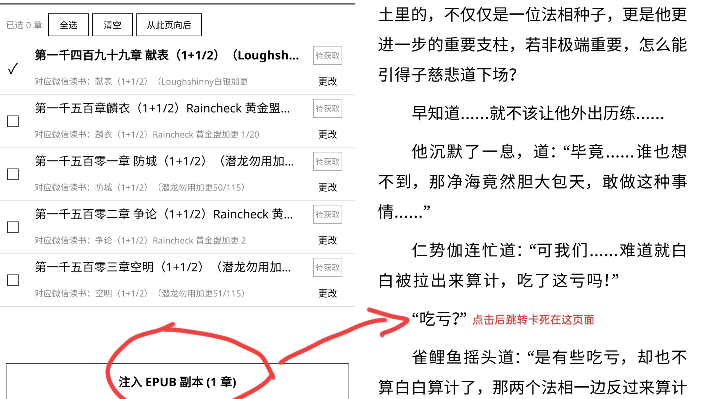

# 注入 EPUB 副本卡死故障报告 (Inject Copy Crash Report)

## 1. 基本信息
- **日期**：2026-11-02
- **设备型号**：KindlePaperWhite4 (分辨率：1448 × 1072)
- **KOReader 版本**：v2026.07.1
- **WeRead 插件版本**：1.6.0-merged
- **关联书籍**：`玄鉴仙族 - 季越人.txt - 初入.epub`
- **微信读书 Book ID**：`45420986` (书籍总章节数：1681)

## 2. 故障现象与操作步骤
1. 打开书籍并进入 WeRead 统一标注 / 章节匹配菜单；
2. 勾选待同步/注入的章节（如示例勾选：`第一千四百九十九章 献表 (1+1/2)`）；
3. 点击底部按钮 **【注入 EPUB 副本 (1 章)】**；
4. 插件触发跳转回阅读页面，但跳转后界面彻底冻结卡死（如截图所示），无法响应触控输入，数分钟后进程异常终止并自动重启。



## 3. 卡死时间记录
- **首次发生时间**：`2026-11-02 03:40:03 ~ 03:40:11`
  - 03:40:03 打开想法数据库 `/mnt/us/koreader/weread/books/45420986/thoughts.db`；
  - 03:40:04 起持续报错数据库写入失败，随后日志中断（设备卡死）；
  - 03:44:52 KOReader 重新启动（`launching... Current time: 11/02/26-03:44:52`）。
- **二次复现时间**：`2026-11-02 03:46:37 ~ 03:46:38`
  - 相同操作与报错再次触发，卡死后于 03:50:45 重启。

## 4. 日志错误信息
```text
11/02/26-03:40:04 WARN  [WeRead] thought_db chapter write failed: chapter_uid= 1686 error= common/lua-ljsqlite3/init.lua:60: ljsqlite3[error] table review_items has no column named review_id
```
*(注：该错误在 chapter_uid 1686, 1687, 1688, 1689, 1690, 1692, 1694, 1695, 1696, 1697 等章节循环报错)*

## 5. 堆栈信息 (Stack Trace)
```lua
common/lua-ljsqlite3/init.lua:60: in function 'err'
common/lua-ljsqlite3/init.lua:235: in function 'E_conn'
common/lua-ljsqlite3/init.lua:241: in function 'T_okcode'
common/lua-ljsqlite3/init.lua:374: in function 'prepare'
plugins/weread.koplugin/weread/lib/thought_db.lua:147: in function 'insert_reviews'
plugins/weread.koplugin/weread/lib/thought_db.lua:196: in function <plugins/weread.koplugin/weread/lib/thought_db.lua:186>
[C]: in function 'pcall'
plugins/weread.koplugin/weread/lib/thought_db.lua:186: in function 'putReviews'
...weread.koplugin/weread/ui/annotation_sync_controller.lua:867: in function <...weread.koplugin/weread/ui/annotation_sync_controller.lua:847>
[C]: in function 'xpcall'
plugins/weread.koplugin/weread/ui/common.lua:134: in function 'action'
frontend/ui/uimanager.lua:1019: in function '_checkTasks'
frontend/ui/uimanager.lua:1465: in function 'handleInput'
frontend/ui/uimanager.lua:1585: in function 'run'
./reader.lua:301: in main chunk
[C]: at 0x00013eb1
```

## 6. 根因分析与尚未确认的问题
1. **数据库字段不匹配**：
   - 报错直接指向 `table review_items has no column named review_id`。
   - `thought_db.lua:147` 在执行预编译 SQL 时，预期表结构存在 `review_id` 字段（或当前设备本地旧有的 `thoughts.db` 表中缺少该字段）。
   - 由于 `ThoughtDB.open()` 采用 `CREATE TABLE IF NOT EXISTS`，若书籍目录下已存在历史版本的 `thoughts.db`，不会触发自动迁移（migration）或字段补齐。
2. **卡死与看门狗重启机理**：
   - 注入副本涉及大量章节匹配与循环处理，当频繁触发 SQL 报错并记录日志时，主线程任务未及时让出时间片，导致 UIManager 输入处理无响应；
   - 最终由系统看门狗超时强行 kill 或由用户被迫重启设备。
3. **尚未确认的问题**：
   - 设备本地数据库文件的生成版本与当前代码版本的具体差异；
   - 是否在清空或删除 `/mnt/us/koreader/weread/books/45420986/thoughts.db` 缓存后能够规避此卡死。

## 7. 相关文件
- 完整原始日志：[`2026-11-02-inject-copy-crash.log`](./2026-11-02-inject-copy-crash.log)
- 现象截图：[`2026-11-02-inject-copy-crash.jpg`](./2026-11-02-inject-copy-crash.jpg)
