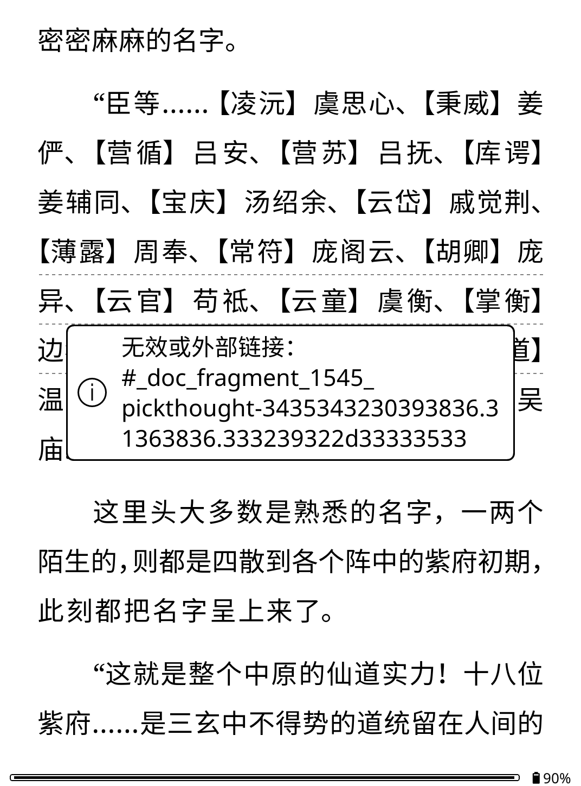

# 注入副本后划线弹出“无效或外部链接”问题报告 (Invalid Link Popup Report)

## 1. 基本信息
- **日期**：2026-11-02
- **设备型号**：KindlePaperWhite4
- **KOReader 版本**：v2026.07.1
- **WeRead 插件版本**：1.6.0 (原 1.6.0-merged 已更新)
- **关联书籍**：`玄鉴仙族 - 季越人.txt - 初入.epub`
- **微信读书 Book ID**：`45420986` (书籍总章节数：1681)

## 2. 问题状态变化（对比首次卡死）
1. **SQLite 报错已消除**：
   - 首次测试中的 `common/lua-ljsqlite3/init.lua:60: ljsqlite3[error] table review_items has no column named review_id` 错误在本次日志中**未再出现**。
2. **章节匹配正常完成**：
   - 日志记录：`annotation_job_queued ... chapters= 1 ... chapter_uid= 1686`
   - 对第 1686 章的 7 条划线进行了匹配，最终成功定位 1 条（`located= 1 unmatched= 6`），整体耗时约 11.8 秒，标注任务保存成功（`ok= true`）。

## 3. 本次新出现的故障现象与步骤
1. 打开书籍并触发注入/匹配章节（`chapter_uid= 1686`）；
2. 注入成功后返回阅读界面；
3. 点击正文中注入的书友想法下划线；
4. **现象**：未能正常弹出微信读书的想法气泡对话框，而是触发了 KOReader 原生未处理链接弹窗：
   ```text
   无效或外部链接：
   #_doc_fragment_1545_pickthought-3435343230393836.31363836.333239322d33333533
   ```



## 4. 链接 Fragment 解码与机理分析
- **弹窗中的 Fragment 串**：`#_doc_fragment_1545_pickthought-3435343230393836.31363836.333239322d33333533`
- **十六进制解码**：
  - `3435343230393836` $\rightarrow$ `45420986`（WeRead Book ID）
  - `31363836` $\rightarrow$ `1686`（Chapter UID）
  - `333239322d33333533` $\rightarrow$ `3292-3353`（Underline Range）
- **机理分析**：
  - 注入到 EPUB 中的 HTML 标签为 `<a href="#_doc_fragment_..._pickthought-...">`；
  - KOReader 渲染引擎将该点击事件作为普通超链接分发；
  - WeRead/PickThought 插件的链接点击拦截器（`ReaderLink` 挂钩或 `UIManager` 事件监听）未能成功捕获或识别该格式的 URL，未调用 `ThoughtPopup` 显示评论；
  - 因而穿透到了 KOReader 的默认外部链接提示窗口，提示“无效或外部链接”。

## 5. 日志摘录与时间线
- `12:50:52`：插件初始化 `[WeRead] initialized: version= 1.6.0`；
- `12:52:14`：出现 `{"errCode":-2012,"errMsg":"登录超时"}`；
- `12:54:06`：扫码重新登录成功 `[WeRead][QRLogin] login completed`；
- `12:54:22 ~ 12:54:34`：执行 chapter 1686 标注匹配，保存成功；
- `12:55:00 左右`：在阅读页面点击想法划线，触发弹窗（如截图所示）。

## 6. 待解决与确认问题
1. **链接拦截格式匹配**：检查 KOReader 插件中注册链接拦截规则（`onTapLink` 或 `onShowDialog`）的正则表达式是否支持 `_doc_fragment_..._pickthought-` 前缀；
2. **EPUB 锚点生成机制**：注入 EPUB 时生成的 `<a href="...">` 链接格式是否与 KOReader 期望拦截的自定义协议或 scheme 一致。

## 7. 相关文件
- 本次日志：[`2026-11-02-inject-copy-invalid-link.log`](./2026-11-02-inject-copy-invalid-link.log)
- 本次截图：[`2026-11-02-inject-copy-invalid-link.png`](./2026-11-02-inject-copy-invalid-link.png)
- 首次崩溃记录（参考）：[`2026-11-02-inject-copy-crash.md`](./2026-11-02-inject-copy-crash.md)
